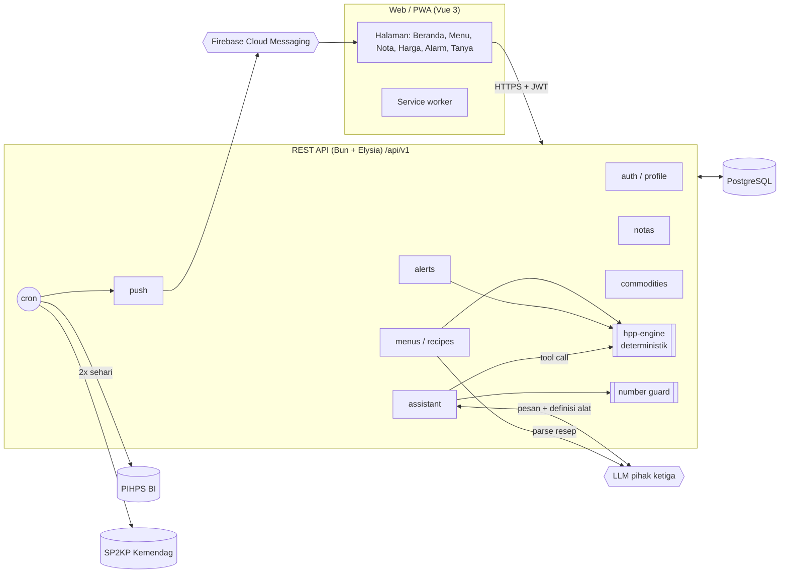
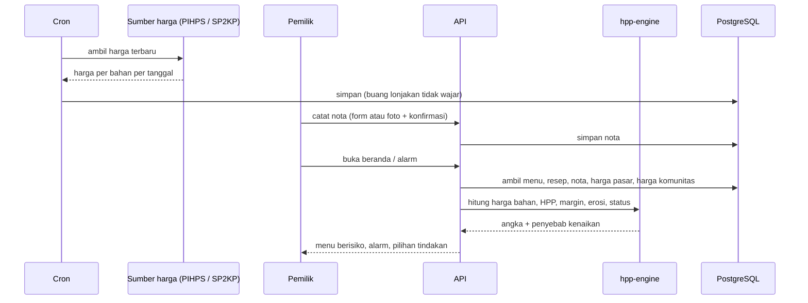
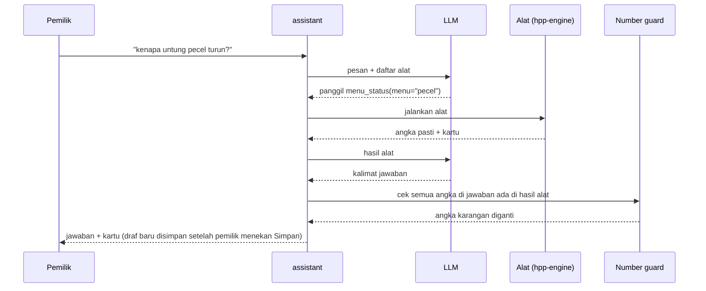

# MyHPPGweh

**Tahu kapan harga menu harus naik, dan berapa.**

MyHPPGweh adalah penjaga margin untuk UMKM kuliner. Aplikasi menghitung HPP (harga pokok penjualan) per porsi dari harga bahan terbaru, melacak berapa banyak untung tiap menu tergerus sejak harga jual terakhir ditetapkan, lalu memberi alarm dan pilihan tindakan: naikkan harga berapa, kurangi porsi, atau ganti bahan.

| | |
|---|---|
| Kompetisi | Logicodix 2026, Hackathon |
| Kategori | **Web** |
| Subtema | Local MSME & Creative Economy |
| Nama tim | Tim |
| Anggota | Rio Putra Pratama - Leader - @fyyyn1210 |
| Aplikasi (deploy) | [ISI: URL web] |
| Video demo | [ISI: URL YouTube] |
| Commit final | [ISI: commit hash] |

---

## Daftar isi
1. [Masalah](#1-masalah)
2. [Solusi](#2-solusi)
3. [Target pengguna](#3-target-pengguna)
4. [Fitur yang sudah berjalan](#4-fitur-yang-sudah-berjalan)
5. [Teknologi](#5-teknologi)
6. [Arsitektur dan alur data](#6-arsitektur-dan-alur-data)
7. [Rumus perhitungan](#7-rumus-perhitungan)
8. [Instalasi dan menjalankan](#8-instalasi-dan-menjalankan)
9. [Akun demo](#9-akun-demo)
10. [Dokumentasi penggunaan AI](#10-dokumentasi-penggunaan-ai)
11. [Etika, privasi, dan keamanan](#11-etika-privasi-dan-keamanan)
12. [Batasan yang diketahui](#12-batasan-yang-diketahui)
13. [Atribusi dan sumber pihak ketiga](#13-atribusi-dan-sumber-pihak-ketiga)

---

## 1. Masalah

Bahan baku adalah komponen biaya terbesar usaha kuliner. Pemilik warung tahu harga bahan **per kilogram** saat belanja, tetapi jarang tahu dampaknya **per porsi** dan **secara kumulatif**:

- **Kenaikan kecil menumpuk tanpa terasa.** Cabai naik Rp15 per porsi, minyak Rp30, kacang Rp40, gas Rp25. Satu per satu terasa kecil. Setelah beberapa bulan, margin 30% bisa tinggal 18%.
- **Reaksi tidak proporsional.** Ada yang menaikkan harga terlalu tinggi dan kehilangan pembeli, ada juga yang tidak sadar margin sudah habis.
- **Harga menu tidak bisa diubah tiap minggu.** Pemilik perlu tahu *kapan* harus naik dan *berapa sekaligus*.
- **Menu banyak.** Warung dengan 20 menu tidak bisa menghitung semuanya di kepala.
- **Pesanan katering dikunci jauh hari.** Harga disepakati hari ini untuk acara beberapa minggu lagi, padahal harga bahan bisa naik sebelum acara.
- **Data harga pangan resmi sudah ada** (PIHPS Bank Indonesia, SP2KP Kemendag), tetapi belum terhubung ke resep dan harga jual pedagang.

Aplikasi kasir (POS) mencatat transaksi, tetapi tidak menjaga margin per menu dari waktu ke waktu.

## 2. Solusi

MyHPPGweh menggabungkan **resep tiap menu** dengan **harga bahan** dari tiga sumber, lalu mengubahnya menjadi keputusan harga:

1. **Nota belanja pemilik sendiri.** Sumber utama, karena paling dekat dengan harga beli sebenarnya.
2. **Harga komunitas.** Median harga nota yang dibagikan pedagang lain di kota yang sama (opt-in dan anonim).
3. **Harga pasar resmi.** PIHPS Bank Indonesia dan SP2KP Kemendag sebagai pembanding, pengisi bahan yang belum dicatat, dan sumber tren harga.

Di atas data itu ada **asisten AI** yang bisa diajak bicara dengan bahasa sehari-hari ("kenapa untung pecel turun?", "pesanan 200 porsi 3 minggu lagi", "tadi beli rawit 2 kilo 150 ribu"). **Semua angka uang dihitung kode deterministik, bukan AI.** AI hanya memahami kalimat, memilih alat hitung, dan menyusun jawaban. Setiap perubahan data dari asisten selalu tampil sebagai kartu konfirmasi dan baru disimpan setelah pemilik menekan Simpan.

## 3. Target pengguna

- **Utama:** pemilik warung makan dan usaha kuliner kecil (warung geprek, penyetan, pecel, nasi, minuman) yang belanja bahan sendiri dan menetapkan harga jual sendiri.
- **Kedua:** usaha katering rumahan yang perlu menghitung harga kutipan pesanan.
- Pengguna diasumsikan memakai ponsel, sehingga antarmuka dirancang *mobile-first* dan bisa dipasang sebagai aplikasi (PWA).

## 4. Fitur yang sudah berjalan

| # | Fitur | Halaman | Keterangan |
|---|---|---|---|
| 1 | **Beranda: menu paling berisiko** | `/` | Ringkasan menu yang untungnya paling tergerus, status merah, kuning, hijau |
| 2 | **Daftar dan detail menu** | `/menu`, `/menu/:id` | HPP hari ini, margin sekarang dibanding margin saat harga jual ditetapkan, tren, bahan penyumbang kenaikan terbesar |
| 3 | **Tambah menu dari teks resep** | `/menu/baru` | Resep ditulis bebas ("5 ons ayam, 3 siung bawang"), AI mengubahnya menjadi kartu bahan yang bisa diedit sebelum disimpan. Satuan lokal (ons, siung, butir, ikat, sendok) dikonversi ke gram |
| 4 | **Kalkulator target margin** | detail menu | Pemilik memilih target untung, aplikasi memberi saran harga jual yang dibulatkan, beserta margin aktual setelah pembulatan |
| 5 | **Alarm erosi margin dan lonjakan harga** | `/alarm` | Alarm saat margin menu turun di bawah ambang pemilik atau harga bahan melonjak |
| 6 | **Catat nota belanja** | `/nota` | Isi bahan, jumlah, dan total harga, atau **foto nota** yang dibaca AI lalu dikonfirmasi pemilik |
| 7 | **Harga bahan dan sumbernya** | `/harga` | Harga terkini tiap bahan dengan label sumber (nota Anda, komunitas, PIHPS, Kemendag, perkiraan), tanggal, dan perubahan 7 hari |
| 8 | **Harga komunitas** | pengaturan (opt-in), sumber harga bahan | Opt-in. Ditampilkan hanya bila ada minimal 3 kontributor di kota yang sama dalam 7 hari terakhir |
| 9 | **Asisten AI dengan pemanggilan alat** | `/tanya` | Tanya status menu, pilihan solusi, harga bahan, menu berisiko, kutipan katering. Bisa menyiapkan draf nota, harga jual baru, menu baru, ubah atau hapus menu. Semua draf lewat kartu konfirmasi |
| 10 | **Riwayat percakapan asisten** | `/tanya/riwayat` | Sesi percakapan sebelumnya (baca saja) |
| 11 | **Kutipan harga katering** | lewat asisten | HPP proyeksi pada tanggal acara dengan buffer kenaikan harga historis, harga tanpa dan dengan buffer |
| 12 | **Notifikasi push** | pengaturan | Firebase Cloud Messaging: kabar harga dan pengingat harian |
| 13 | **PWA** | semua | Bisa dipasang di layar utama, *app shell* di-cache |
| 14 | **REST API terdokumentasi** | `/api/docs` | OpenAPI dan Scalar (aktif di mode non-produksi) |
| 15 | **Sinkronisasi harga otomatis** | server | Cron dua kali sehari mengambil harga PIHPS dan SP2KP lalu menyimpannya ke database |

## 5. Teknologi

### Backend (`server/`)
| Komponen | Teknologi |
|---|---|
| Runtime | [Bun](https://bun.sh) |
| Framework HTTP | [Elysia](https://elysiajs.com) + `@elysiajs/openapi`, `@elysiajs/jwt`, `@elysiajs/cors`, `@elysiajs/cron` |
| Database | PostgreSQL |
| ORM dan migrasi | [Drizzle ORM](https://orm.drizzle.team) + drizzle-kit |
| Autentikasi | JWT (access dan refresh token), password di-hash dengan `bcryptjs` |
| Validasi env | `envalid` |
| Logging | `pino`, `pino-pretty`, `pino-roll` |
| Notifikasi | `firebase-admin` (Firebase Cloud Messaging) |
| AI | API kompatibel OpenAI (chat completions + tool calling) lewat penyedia pihak ketiga, lihat [bagian 10](#10-dokumentasi-penggunaan-ai) |
| Pengujian | `bun test` (uji API dan asisten) + skrip pengecekan engine, parser resep, dan parser PIHPS |

### Frontend (`web/`)
| Komponen | Teknologi |
|---|---|
| Framework | Vue 3 + Vue Router + TypeScript |
| Build | Vite |
| Styling | Tailwind CSS 4 |
| Animasi | `motion-v`, `lenis` |
| Ikon | Hugeicons (`@hugeicons/vue`, `@hugeicons/core-free-icons`) |
| Font | Poppins (Google Fonts) |
| Notifikasi | Firebase JS SDK (Cloud Messaging) |
| PWA | `manifest.webmanifest` + service worker `public/sw.js` |

### Layanan dan data pihak ketiga
| Layanan | Kegunaan |
|---|---|
| PIHPS Bank Indonesia | Harga pangan harian per provinsi |
| SP2KP Kementerian Perdagangan | Harga rata-rata bahan pokok, pelengkap PIHPS |
| `harga-pangan.fly.dev` | Mirror publik data PIHPS, cadangan bila situs BI tidak bisa diakses |
| Penyedia LLM (kompatibel OpenAI) | Asisten, parsing resep, baca foto nota |
| Firebase Cloud Messaging | Notifikasi push |

## 6. Arsitektur dan alur data

### Arsitektur



Modul backend ada di `server/src/modules/`: `auth`, `profile`, `menus`, `recipes`, `notas`, `commodities`, `hpp`, `alerts`, `assistant`, `push`.

### Alur data: dari harga bahan sampai alarm



### Alur data: asisten AI



## 7. Rumus perhitungan

Semua rumus ada di `server/src/modules/hpp/hpp.engine.ts`.

- **Margin** dihitung atas harga jual: `margin = (harga_jual - HPP) / harga_jual`.
- **Saran harga jual** dari target margin: `harga = HPP / (1 - target_margin)`, lalu dibulatkan. Margin aktual setelah pembulatan ikut ditampilkan.
- **HPP per porsi** = jumlah (takaran bahan dalam gram × harga per gram) + biaya lain per porsi (kemasan, gas, dan lain-lain).
- **Urutan harga bahan:** nota pemilik (maksimal 14 hari), lalu median komunitas di kota yang sama (7 hari, minimal 3 kontributor), lalu harga pasar (PIHPS, lalu SP2KP, lalu harga perkiraan) × faktor kalibrasi dari nota pemilik.
- **Faktor kalibrasi** = median (harga nota / harga pasar pada tanggal yang sama).
- **Erosi margin** = margin saat harga jual terakhir ditetapkan − margin hari ini.
- **Kutipan katering:** HPP diproyeksikan ke tanggal acara memakai buffer kenaikan harga historis tiap bahan, lalu `harga = HPP_proyeksi / (1 - target_margin)`.

Bila pengecekan engine dijalankan dengan `bun run check`, rumus utama diuji dengan contoh angka yang hasilnya diketahui.

## 8. Instalasi dan menjalankan

### Prasyarat
- [Bun](https://bun.sh) 1.x
- PostgreSQL 15 atau lebih baru
- API key penyedia LLM yang kompatibel OpenAI (opsional, tanpa ini asisten jatuh ke mode kata kunci)
- Project Firebase (opsional, hanya untuk notifikasi push)

### 1) Clone

```bash
git clone https://github.com/fyyyn1210/my-hpp-gweh.git
cd my-hpp-gweh
```

### 2) Backend

```bash
cd server
bun install
cp .env.example .env
```

Isi `.env` (lihat tabel di bawah), lalu:

```bash
bun run db:migrate
bun run db:seed
bun run prices:sync
bun run dev
```

API berjalan di `http://localhost:3000`, dokumentasi API di `http://localhost:3000/api/docs`.

`db:seed` mengisi katalog bahan. Bila belum ada harga PIHPS sama sekali, seed juga mengisi deret harga contoh agar aplikasi bisa dicoba. `prices:sync` mengambil harga asli dari PIHPS dan SP2KP. Jalankan `prices:sync` sebelum demo supaya angka yang tampil berasal dari data asli.

### 3) Frontend

```bash
cd web
bun install
cp .env.example .env
bun run dev
```

Web berjalan di `http://localhost:5173`. Permintaan `/api` diteruskan ke `http://localhost:3000` oleh proxy Vite.

Build produksi:

```bash
bun run build
```

### 4) Pengujian

```bash
cd server
bun test
bun run check
```

### Variabel lingkungan

`server/.env.example`

| Variabel | Keterangan |
|---|---|
| `NODE_ENV` | `development` atau `production` (dokumentasi API dimatikan di produksi) |
| `APP_PORT` | Port API, bawaan `3000` |
| `APP_CLIENT_TIMEZONE` | Zona waktu klien yang diizinkan |
| `PRETTY_LOGGING`, `LOG_LEVEL` | Format dan level log |
| `DATABASE_NAME`, `DATABASE_USER_NAME`, `DATABASE_PASSWORD`, `DATABASE_HOST`, `DATABASE_PORT`, `DATABASE_SSL` | Koneksi PostgreSQL |
| `JWT_ACCESS_TOKEN_KEY`, `JWT_REFRESH_TOKEN_KEY` | Rahasia acak untuk JWT |
| `JWT_ACCESS_EXPIRES_IN`, `JWT_REFRESH_EXPIRES_IN` | Masa berlaku token dalam detik |
| `AI_ENGINE_BASEURL`, `AI_ENGINE_APIKEY` | Endpoint dan kunci penyedia LLM |
| `AI_ENGINE_MODEL` | Model utama |
| `AI_ENGINE_FALLBACK_MODELS` | Model cadangan, dipisah koma, dicoba berurutan |
| `AI_ENGINE_VISION_MODELS` | Model yang bisa membaca foto nota |
| `FIREBASE_PROJECT_ID`, `FIREBASE_CLIENT_EMAIL`, `FIREBASE_PRIVATE_KEY` | Service account Firebase untuk push |

`web/.env.example`

| Variabel | Keterangan |
|---|---|
| `VITE_API_URL` | Base URL API, bawaan `/api/v1` |
| `VITE_FIREBASE_API_KEY`, `VITE_FIREBASE_PROJECT_ID`, `VITE_FIREBASE_MESSAGING_SENDER_ID`, `VITE_FIREBASE_APP_ID`, `VITE_FIREBASE_VAPID_KEY` | Konfigurasi Firebase untuk notifikasi push di browser |

File `.env` tidak masuk repo (lihat `.gitignore`). Jangan menulis kunci asli di `.env.example`.

## 9. Akun demo

| | |
|---|---|
| URL | [ISI: URL web] |
| Email | [ISI: email akun demo] |
| Password | [ISI: password akun demo] |

Juri juga bisa membuat akun baru lewat halaman **Daftar** tanpa biaya atau akses khusus. Akun baru dimulai kosong, jadi untuk melihat alarm dan menu berisiko, gunakan akun demo yang sudah berisi menu.

## 10. Dokumentasi penggunaan AI

### Layanan dan model
AI diakses lewat **penyedia pihak ketiga dengan API kompatibel OpenAI** (`AI_ENGINE_BASEURL`). Model diatur lewat `.env`, bukan ditulis di kode. Konfigurasi bawaan di `.env.example`:

| Peran | Model bawaan |
|---|---|
| Utama | `deepseek-v4-flash` |
| Cadangan (dicoba berurutan bila model utama gagal) | `glm-5.3`, `kimi-k2.6`, `deepseek-v4.1-flash`, `gpt-5.6-luna` |
| Baca foto nota (vision) | `deepseek-v4.1-flash` |


### Bagian produk yang memakai AI
| Bagian | Peran AI | Yang tetap dikerjakan kode |
|---|---|---|
| Tambah menu dari teks (`recipes`) | Mengubah resep bebas menjadi daftar bahan, takaran, dan satuan | Validasi skema, konversi satuan ke gram, pencocokan ke katalog bahan, hitung HPP |
| Asisten `/tanya` (`assistant`) | Memahami pertanyaan, memilih alat, menyusun kalimat jawaban | 10 alat deterministik: `menu_status`, `price_options`, `ingredient_price`, `risky_menus`, `catering_quote`, `draft_nota`, `draft_sell_price`, `draft_new_menu`, `draft_menu_change`, `draft_menu_delete` |
| Foto nota | Membaca item, jumlah, dan total dari foto | Hasil tampil sebagai draf, disimpan hanya setelah dikonfirmasi pemilik |
| Menu tanpa resep | Bila pemilik hanya menyebut nama menu, AI mengusulkan resep umum | Diberi label **"saran AI"**, pemilik wajib memeriksa takaran sebelum menyimpan |

### Pengaman
- **AI tidak menghitung uang.** HPP, margin, saran harga, dan kutipan katering selalu dari `hpp-engine`.
- **Number guard** (`assistant.guard.ts`): setiap angka di jawaban AI dicocokkan dengan angka dari hasil alat. Angka yang tidak berdasar diganti sebelum jawaban dikirim.
- **Tidak ada aksi tulis otomatis.** Alat `draft_*` hanya menyiapkan kartu, dan data baru tersimpan setelah pemilik menekan Simpan.
- **Batas pemakaian:** 50 pesan AI per pengguna per hari, riwayat konteks 20 pesan, dan jawaban berulang di-cache.
- **Fallback:** bila semua model gagal atau batas harian tercapai, asisten beralih ke mode kata kunci tanpa AI, dan form manual tetap bisa dipakai.

### Alat bantu pengembangan
[ISI: sebutkan AI coding assistant yang dipakai selama pengembangan, misalnya Claude Code, dan untuk bagian apa]

## 11. Etika, privasi, dan keamanan

- **Transparansi sumber harga.** Setiap harga diberi label sumber (nota Anda, komunitas, PIHPS, Kemendag, perkiraan) dan tanggal. Harga perkiraan diberi label "Perkiraan".
- **Harga komunitas bersifat opt-in dan anonim.** Hanya kota yang dibagikan, tanpa nama atau lokasi warung. Harga ditampilkan hanya bila ada minimal 3 kontributor, dan yang dipakai adalah median, bukan rata-rata.
- **Data pemilik.** Resep, nota, dan harga jual milik pemilik dan hanya bisa diakses akun pemilik.
- **Data ke pihak ketiga.** Teks yang dikirim ke asisten, teks resep, dan foto nota diproses oleh penyedia LLM pihak ketiga. Pengguna perlu tahu ini sebelum memakai fitur AI.
- **Data SP2KP.** Respons SP2KP berisi data petugas pencatat. Aplikasi hanya menyimpan kolom harga.
- **Keamanan dasar.** Password di-hash dengan bcrypt, JWT dengan masa berlaku singkat dan refresh token, validasi input lewat skema Elysia, CORS dibatasi di produksi, dan dokumentasi API dimatikan di produksi.
- **Kredensial.** Semua kunci disimpan di `.env` yang tidak masuk repo. Repo hanya berisi `.env.example`.
- **Waktu.** Server menyimpan dan mengolah waktu dalam UTC, dan respons memakai ISO 8601 dengan zona waktu.

## 12. Batasan yang diketahui

Dicatat jujur agar juri tahu batas MVP ini:

- Harga PIHPS dan SP2KP adalah harga rata-rata per wilayah, bukan harga beli tiap warung. Karena itu nota pemilik dipakai lebih dulu dan harga pasar dikalibrasi dengan nota.
- Konversi satuan lokal (misalnya 1 butir, 1 siung) memakai perkiraan berat rata-rata.
- Pencocokan nama bahan ke katalog masih berbasis teks, jadi pemilik wajib memeriksa kartu bahan sebelum menyimpan.
- Buffer katering dihitung dari histori harga yang tersedia di database. Histori multi-tahun belum dimuat.
- Harga komunitas kosong sampai cukup banyak pedagang di kota yang sama ikut berbagi.
- PWA belum mendukung pencatatan saat offline.
- Token login disimpan di `localStorage`.

Daftar lengkap ada di `TODO.md`.

## 13. Atribusi dan sumber pihak ketiga

### Data
- **PIHPS Nasional, Bank Indonesia.** Harga pangan harian. https://www.bi.go.id/hargapangan. Data dipakai sebagai referensi harga pasar dan tetap milik Bank Indonesia.
- **SP2KP, Kementerian Perdagangan RI.** Harga rata-rata bahan pokok. https://sp2kp.kemendag.go.id. Data tetap milik Kementerian Perdagangan.
- **harga-pangan.fly.dev.** Mirror publik data PIHPS, dipakai sebagai cadangan.

### Pustaka dan aset
- Bun, Elysia, Drizzle ORM, PostgreSQL, Vue, Vue Router, Vite, Tailwind CSS, motion-v, Lenis, Firebase, pino, bcryptjs, envalid. Lisensi mengikuti masing-masing pustaka (lihat `package.json` di `server/` dan `web/`).
- Ikon: [Hugeicons](https://hugeicons.com) (paket gratis).
- Font: [Poppins](https://fonts.google.com/specimen/Poppins), Google Fonts, SIL Open Font License.
- Logo dan ikon aplikasi: [ISI: dibuat sendiri / sumber]

### Template dan kode
Proyek ini tidak memakai template aplikasi jadi. Struktur proyek dibuat dari awal selama Hacking Week Logicodix 2026 (7–14 November 2026).
